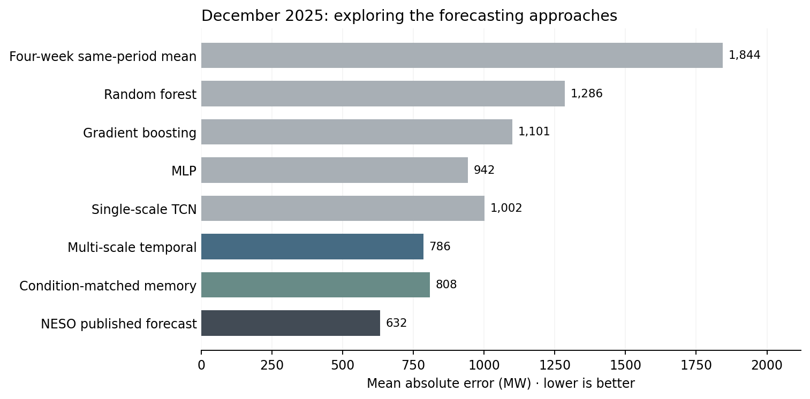
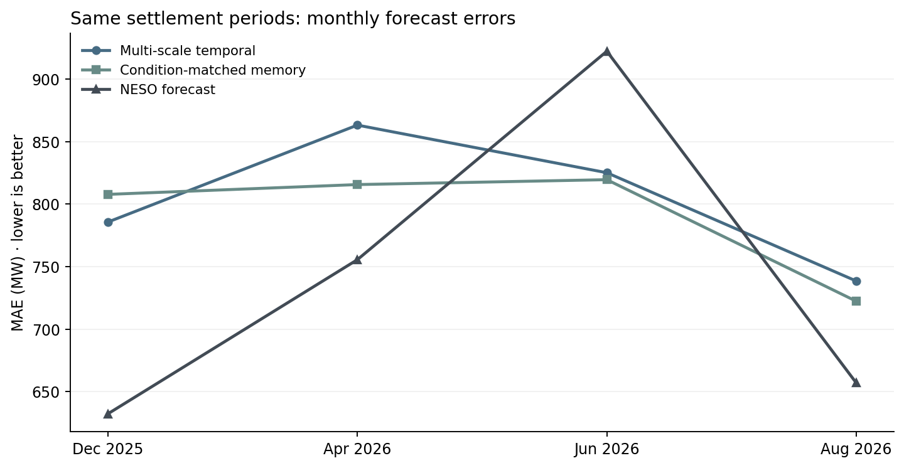

# GB Electricity Demand Forecasting

A small project exploring short-term electricity demand forecasting in Great Britain, starting with simple historical baselines and gradually adding weather, calendar features and neural networks.

I started working on this while learning about electricity markets. I wanted to understand how demand forecasts are built, what makes them difficult, and whether more complicated models actually give better results.

The data comes mainly from NESO, with additional weather forecasts, school and bank holidays, and wind and solar generation forecasts.

The target is half-hourly electricity demand (`Demand_Outturn`, MW), not electricity prices.

## What I tried

I started with two basic forecasts: using demand from the same half-hour last week, and averaging the corresponding half-hours over the previous four weeks.

Both work reasonably well as starting points because electricity demand has strong daily and weekly patterns. They are less useful when conditions change, particularly around holidays or unusual weather.

I then added more information and tried several models.

| Stage | Models | What I wanted to test |
|---|---|---|
| 1 | Previous week, four-week average | How much can historical demand alone explain? |
| 2 | Ridge, Random Forest, Gradient Boosting | Do weather and calendar features improve the forecast? |
| 3 | MLP, TCN | Can a neural network learn useful relationships from recent demand sequences? |
| 4 | Multi-Scale Temporal Model | Does combining short- and long-term history work better? |
| 5 | Condition-Matched Memory Model | Can similar historical conditions provide an additional correction? |

### Moving beyond a single time window

One thing I noticed early on was that a more complex model wasn't necessarily better. My first single-scale TCN performed worse than a simpler MLP in the December experiment.

I suspected that using only a short sequence was limiting what the model could learn.

The next version used three different views of historical demand:

- **14 days** of half-hourly data for recent changes.
- **365 days** of daily summaries for medium-term and seasonal patterns.
- **156 weeks** of weekly history for longer-term behaviour.

I called this the **Multi-Scale Temporal Model**. It uses separate temporal encoders and also includes historical demand from comparable dates in previous years.

This gave a noticeable improvement in the initial December tests.

### Using historical conditions, not just dates

I then tried a different way of using older data.

Two days in different years might have similar weather, school-holiday patterns and generation conditions, even if they aren't close on the calendar.

The **Condition-Matched Memory Model** keeps the multi-scale temporal model as its starting point, but adds a historical retrieval component.

It searches roughly three years of available history, selects up to 24 days using a predefined similarity score, and uses attention to learn how their demand responses might help correct the forecast.

The similarity search is still partly hand-designed; the attention weights and forecast correction are learned during training.

I wanted to see whether this extra historical information was worth the additional complexity.

## Results

### Earlier experiments

The first chart shows results from the December 2025 experiments, moving from simple baselines to neural networks and multi-scale modelling.



These are exploratory results. The models were not all trained using identical pipelines, so I wouldn't treat this chart as a strict benchmark.

### Comparing the final two models

I made a separate comparison using the same 5,848 half-hour periods across 122 days in December 2025 and April, June and August 2026.

| Month | Multi-Scale Temporal | Condition-Matched Memory | NESO |
|---|---:|---:|---:|
| Dec 2025 | **785.7** | 807.8 | 632.3 |
| Apr 2026 | 863.2 | **815.6** | 755.6 |
| Jun 2026 | 825.1 | **819.5** | 922.3 |
| Aug 2026 | 738.5 | **722.3** | 657.0 |
| **Overall** | **802.4** | **790.9** | **740.2** |

*Mean absolute error (MAE), in MW. Lower is better. Bold highlights the better of my two models.*



The memory model reduced overall MAE by **11.5 MW (1.4%)** compared with the multi-scale model.

That's a fairly small improvement. It performed better on 62 of the 122 days, while the multi-scale model performed better on 60.

There were some large differences on individual days. The additional memory correction helped considerably on 26 June 2026, but made the prediction much worse on 19 December 2025.

So far, I haven't found a reliable way to tell in advance when the historical correction will help. The overall improvement is also too small and uncertain to claim a consistent advantage.

Neither model beat the NESO forecast overall.

## Things I'd like to investigate further

**Weather and changing demand patterns**

I'm particularly interested in how the relationship between temperature and electricity demand changes over time.

For example, warmer summers, changing heating and cooling behaviour, and longer-term changes in energy use could make older demand patterns less representative of current conditions.

The current models include weather and seasonal information, but I haven't separately measured the effect of long-term climate change. That would need a more focused analysis.

**Holidays**

School holidays turned out to be an important part of the data preparation, especially because holiday schedules vary across the UK.

I used population-weighted school-holiday information alongside bank holidays. I'd like to look more closely at how demand behaves around the start and end of holiday periods.

**When more history becomes less useful**

The memory experiments raised another question: if a model finds similar conditions in the past, how do we know the demand response is still relevant?

I'd like to investigate this rather than simply increasing the number of historical days the model can access.

## Why this matters for electricity markets

Demand is only one part of the electricity market, but it's an important input.

Unexpected changes in demand, especially when combined with changes in wind and solar generation, can affect residual demand and the balance between supply and consumption.

This project focuses on demand forecasting. It doesn't predict wholesale electricity prices, model market settlements or estimate trading profits.

For now, I'm mainly interested in understanding the data and building a better foundation for analysing GB electricity markets.

## Data and reproducibility

The project uses:

- NESO historical half-hourly demand and demand forecasts.
- Historical weather forecasts covering five British cities.
- NESO archived wind and solar generation forecasts.
- UK bank holidays and population-weighted school holidays.

The evaluation uses historical data, but I haven't independently verified the publication timestamp of every archived forecast input. I therefore treat the results as exploratory rather than fully verified live forecasting backtests.

The evaluation months were also examined during development, which limits how much can be concluded about future performance. Eight half-hour records are missing from the aligned April comparison and were not filled in.

This repository contains the saved predictions, a summary of the earlier experiments and a small script to reproduce the reported metrics and plots. It doesn't contain the full original training environment.

To reproduce the results:

```bash
pip install -r requirements.txt
python reproduce.py
```

### Data sources

[NESO Data Portal](https://www.neso.energy/data-portal) · [NESO Demand Forecast Performance](https://www.neso.energy/data-portal/day-ahead-half-hourly-demand-forecast-performance) · [Open-Meteo Historical Forecast API](https://open-meteo.com/en/docs/historical-forecast-api)